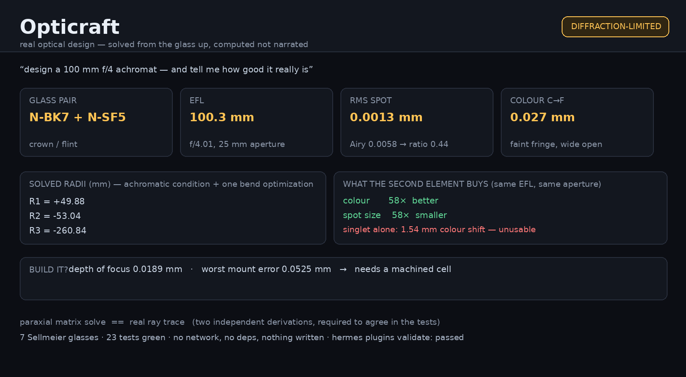

# Opticraft

**Real optical design inside Hermes — computed, not narrated.**



Ask for a lens and Opticraft solves it from the glass up: which two glasses,
what radii, how much colour error is left, how big the blur is against the
diffraction limit, and whether a normal person with a lathe can actually hold it
to tolerance. Every number comes out of a Sellmeier catalogue and an exact
meridional ray trace. There is no model call anywhere in the engine.

## What it answers

| Tool | What it returns |
|---|---|
| `opticraft_design` | a cemented achromat for a target EFL and aperture: the three radii, the two element powers, the computed RMS spot, the residual colour error, and the same lens as a **singlet for comparison** |
| `opticraft_trace` | paraxial EFL/BFD/f-number plus the exact meridional trace, spherical aberration, blur at focus and a spot diagram, for any prescription you already have |
| `opticraft_spot` | the ray fan, RMS spot, Airy disc and **ratio between them** — the number that answers "is this lens good?" |
| `opticraft_colour` | axial focus shift between the C (656 nm) and F (486 nm) lines, with a verdict |
| `opticraft_tolerance` | focus shift from decentre, tilt and spacer error, measured against the Rayleigh depth of focus |
| `opticraft_glass` | the glasses it can design with, nd and Vd *evaluated* from the Sellmeier terms, plus index at any wavelength |

## Why the numbers can be trusted

Two independent derivations of the same optical system are computed and required
to agree:

- **paraxial**: ray-transfer matrices `[[1,0],[-φ,1]]` and `[[1,t/n],[0,1]]`,
  multiplied through the system → EFL = −1/C, BFD = −A/C
- **real trace**: vector Snell's law at each spherical surface
  (`t = ηi + (η cos i − cos t) n̂`), intersecting the actual sphere, not an
  paraxial stand-in

`tests/test_trace.py` asserts the real trace converges to the paraxial answer as
the aperture shrinks. That is the check that makes the rest of the output
believable, because everything else — spherical aberration, the marginal focus,
the spot — is the *difference* between those two.

The glass data is pinned the same way: every Sellmeier set is verified against
the manufacturer's published nd and Vd (5 decimal places on nd). A mistyped
coefficient fails the build instead of silently mis-designing the lens.

## The design is solved, not looked up

A cemented doublet fixes its two element powers from the achromatic condition:

```
φ_c + φ_f = φ            φ_c/V_c + φ_f/V_f = 0
⇒ φ_c = V_c/(V_c − V_f) · φ     φ_f = −V_f/(V_c − V_f) · φ
```

That leaves exactly **one free parameter** — the internal radius R2 shared by
both elements — so the engine sweeps it and keeps the shape with the smallest
computed RMS spot. A real 100 mm f/4 achromat falls out of first principles:

```
EFL 100 mm, aperture 25 mm, N-BK7 + N-SF5
  radii: 49.88 / −53.04 / −260.84 mm
  RMS spot 0.00127 mm vs Airy 0.00575 mm  → ratio 0.44, diffraction-limited
  colour error 0.027 mm  → a faint fringe only at the widest aperture
  vs the same lens in one element: 58× less colour, 58× smaller spot
```

Those two comparison factors are the honest version of "achromats are better":
they are computed from the same trace, on the same focal length, at the same
aperture.

## What it does not hide

- **Spherical aberration is reported, not smoothed away.** The marginal rays focus
  closer than the axial ones, and the report gives that distance in millimetres.
- **Blur is measured against the Airy disc**, so "diffraction-limited" is a
  computed ratio, not a compliment. At or below 1.0, stopping down cannot help.
- **Tolerance is a verdict, not a disclaimer.** At f/4 the depth of focus is
  ~0.019 mm, so a 0.05 mm decentre genuinely does exceed it — the engine says
  "needs a machined cell" instead of pretending a hobby build will do.
- **Vignetting is reported.** A ray that misses the clear aperture returns
  `vignetted` rather than being silently dropped.

## Install

```bash
hermes plugins install DECRUX9812/hermes-plugin-opticraft --enable
```

No API key, no Python dependency, no account, nothing written to disk. Pure
Python — no numpy, so it runs in any Hermes environment.

## Use

```
> design a 100 mm f/4 achromat and tell me how good it really is

🔭 opticraft_design
   N-BK7 + N-SF5 · EFL 100.3 mm · f/4.01
   radii 49.88 / −53.04 / −260.84 mm
   RMS spot 0.0013 mm vs Airy 0.0058 mm → diffraction-limited
   colour 0.027 mm (C→F) — faint fringe only at the widest aperture
   the same lens in one element: 58× worse colour, 58× bigger spot

> can I build that in my shop?

🔭 opticraft_tolerance
   depth of focus 0.0189 mm · worst mount error 0.0525 mm
   → needs a machined cell, not a printed one
```

## Scope and limits

- Designs **cemented achromatic doublets** (crown + flint). Not a general lens
  optimizer: no aspheres, no multi-element groups beyond two, no field
  optimization of coma/astigmatism.
- **Meridional rays only** (the plane containing the axis). That is enough for
  spherical aberration, axial colour and focus, which is what the tools report.
  Off-axis aberrations beyond a lateral spot estimate are out of scope.
- **Seven glasses**, chosen because they are the real crown/flint pairs people
  build achromats from, not because a longer list looked better.
- **Not a substitute for a design package.** It is a fast, honest first look you
  can run in a chat, and it tells you when the answer is "this will not work."

## Disclosure

- **Network calls:** none.
- **Reads outside its own data:** nothing. The glass catalogue is in the source.
- **Writes:** nothing at all. No data directory, no cache, no state.
- **Credentials:** none requested, none stored.
- **Shell commands / subprocesses:** none.
- **Python dependencies:** none.
- **Telemetry:** none.

## Tests

```bash
python3 -m pytest tests/ -q          # 23 tests: glass, trace, achromat, spot, tolerance
hermes plugins validate .            # the same gate catalog CI runs
```

The suite is deliberately adversarial about physics: it requires the real trace
to reproduce the paraxial result, requires the doublet to beat the singlet by a
measured factor on both colour and spot, requires the Airy diameter to scale
with f-number, and requires an impossible f-number to be refused with a reason.

## Licence

MIT. Sellmeier coefficients from Schott optical-glass data sheets, cross-checked
against the coefficient table in `ofiber` (MIT).
